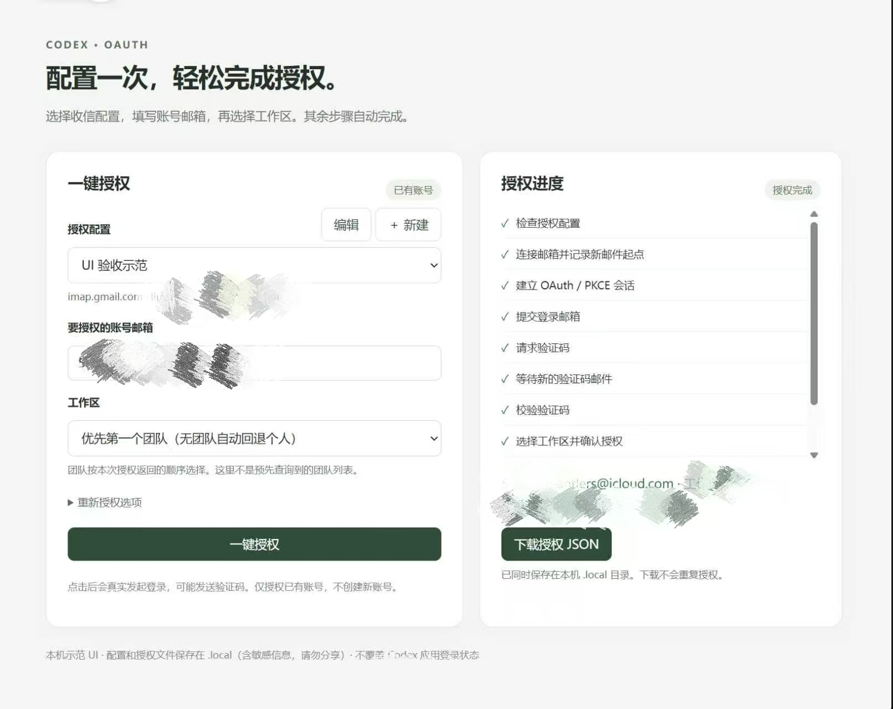

# 在 Codex 中一键完成 OAuth 授权

**中文** | [English](README_EN.md)

配置一个能收验证码的邮箱，选择这份配置，填写要授权的账号邮箱和工作区，再点击“一键授权”。程序自动完成登录、收信、工作区确认和 Token 交换，成功后保存授权 JSON。示范 UI 和命令行共用同一套完整协议核心。

## 先看实现逻辑

```text
选择授权配置 + 登录邮箱 + 工作区
  → 连接 IMAP，记录发送前的邮件 UID 起点
  → 创建 OAuth state / PKCE，建立设备 ID 和 Cookie 会话
  → 提交邮箱，为受保护请求生成 Sentinel 请求头
  → 进入验证码登录，读取新邮件；必要时最多重发一次
  → 提交验证码，确认团队或个人工作区
  → 校验回调 code / state，用 PKCE verifier 交换 Token
  → 核对登录邮箱和本次工作区，保存授权 JSON
```

这是实际发请求的实现，不是只有界面的演示。授权、IMAP、传输、Sentinel 和工作区处理等 10 个核心文件与现有项目对应文件一致；移植时去掉了面板、数据库、队列、批量管理和自定义脚本，新增独立配置、CLI 和本机 UI。默认运行完整核心，不运行下面提到的简化教学文件。

**授权协议与现有项目相同，移植后的代码有完整调用链。** 项目维护者已确认真实账号授权成功，下面提供授权完成后的界面作为使用参考。自动化测试另行覆盖模拟授权和本地 Python 传输。使用时配置自己的已有账号、收件邮箱和代理即可。

## 1. 最方便的用法：示范 UI



上图展示实际授权完成后的界面：左侧选择授权配置、填写登录邮箱和工作区；右侧显示各阶段进度，完成后可以下载授权 JSON。账号信息已由图片提供者遮挡，图片仅作操作参考。

需要 Node.js 22+、Python 3.10+。在仓库目录执行：

```powershell
npm ci
python -m venv .venv
.\.venv\Scripts\python.exe -m pip install -r requirements.txt
$env:CURL_CFFI_PYTHON = ".venv/Scripts/python.exe"
npm run ui
```

打开终端输出的 **http://127.0.0.1:17855**：

1. 点击“新建”，填写配置名称、IMAP 服务器、用户名和邮箱应用专用密码，保存。
2. 在“授权配置”中选择刚保存的配置，填写已有 OpenAI/Codex 账号的登录邮箱。
3. 选择工作区：默认优先第一个团队，无团队自动回退个人；也可以明确选个人，或指定其他团队序号。
4. 点击“一键授权”，查看阶段进度。成功后点击“下载授权 JSON”。

邮箱和代理只配置一次，后续授权只需选配置、填邮箱、选工作区。编辑配置时密码留空表示保留已存密码。高级设置包含收件文件夹、发件人过滤、验证码正则、等待时间和重发时间。

UI 使用本机服务，不依赖原项目的面板、数据库、Vue、Playwright 或浏览器自动化。浏览器只负责显示表单，登录请求由本机协议服务发送。

- 配置保存在 `.local/profiles.json`，包含邮箱密码；授权文件保存在 `.local/auth-<任务ID>.json`。该目录已被 Git 忽略，文件没有额外加密，请只保留在自己的设备上。
- 页面不回显已保存的密码，不把 Token 放进进度接口；Token 仅在成功下载时返回。
- 同时只运行一个授权，支持取消和 Ctrl+C。刷新页面可恢复当前任务进度，轮询和下载都不会重新授权；重启服务后仍保留配置和已生成文件。
- UI 只监听 `127.0.0.1`。改端口可先设置 `$env:UI_PORT = "17856"`，然后重新启动。

Linux/macOS 将安装和启动改为：

```bash
python3 -m venv .venv
.venv/bin/python -m pip install -r requirements.txt
CURL_CFFI_PYTHON=.venv/bin/python npm run ui
```

## 2. 命令行用法和配置

```powershell
Copy-Item .env.example .env
# 修改 .env，再执行：
npm run authorize
```

Windows `.env` 中设置 `CURL_CFFI_PYTHON=.venv/Scripts/python.exe`；Linux/macOS 使用 `.venv/bin/python`。CLI 的输出路径默认是 `codex-auth.json`。**UI 和 CLI 都不会自动覆盖 Codex 应用自己的登录文件**；产物是供调用方导入的平铺凭据 JSON，不应直接假定它与每种 Codex 客户端的内部文件格式兼容。

| 字段 | 作用 |
| --- | --- |
| `LOGIN_EMAIL` | 要授权的已有账号；不注册新账号 |
| `IMAP_HOST` / `IMAP_PORT` | TLS IMAP 地址；端口默认 993 |
| `IMAP_USER` / `IMAP_PASSWORD` | 收信用户名和邮箱应用专用密码；不是 OpenAI 密码 |
| `MAILBOX_ADDRESS` | 实际收件地址；默认 IMAP 用户名，转发场景可与登录邮箱不同 |
| `IMAP_FOLDER` | 默认 `INBOX`，邮件被规则移到其他文件夹时填写对应文件夹 |
| `OTP_PATTERN` | 默认 `\b(\d{6})\b`；第一个捕获组必须是验证码 |
| `OTP_SENDER` | 可选的精确发件人邮箱过滤 |
| `MAILBOX_WAIT_SECONDS` | 收信等待 30–180 秒，默认 90 |
| `EMAIL_RESEND_SECONDS` | 等待 10–90 秒后重发一次，默认 30 |
| `WORKSPACE_INDEX` | `0` 选个人，`1+` 按可用团队返回顺序选择，默认 `1` |
| `EXPECTED_ACCOUNT_ID` | 可选的旧工作区 ID；填写后优先保持该身份 |
| `AUTH_PROXY_URL` | OAuth/Sentinel 的 HTTP、HTTPS 或 SOCKS 代理；空值直连 |
| `CURL_CFFI_PYTHON` | 安装了 `curl_cffi` 的 Python 路径 |
| `OUTPUT_FILE` | CLI 输出路径，默认 `codex-auth.json` |

本机代理可填 `http://127.0.0.1:7890`。OAuth 和 Sentinel 共用同一个传输实例及显式代理，Cookie 按域隔离，IMAP 直连。Python 使用 `trust_env=False`，因此不能只设置系统 `HTTPS_PROXY` 而不填写授权代理。

## 3. 请求究竟怎样发出去

### OAuth 会话和传输

`protocol-auth.mjs` 每次创建随机 `state` 和 PKCE `verifier`，将其 SHA-256 challenge 放入 `/oauth/authorize`。当前代码中的客户端 ID 为 `app_EMoamEEZ73f0CkXaXp7hrann`，回调地址为 `http://localhost:1455/auth/callback`，scope 为 `openid profile email offline_access`。

请求通过这条链路发送：

```text
UI / CLI
  → buildTask(config)
  → authorizeWithProtocol(task, executeScript, signal, report)
  → Node 请求封装：Cookie、设备 ID、请求头、重定向和响应检查
  → curl-cffi-fetch.mjs：通过 stdin/stdout 发送 JSON Lines
  → curl-transport.py：同一个 curl_cffi Session + Chrome 142 TLS 配置
  → auth.openai.com / sentinel.openai.com
```

Node 使用 `tough-cookie` 按 URL 保存和附加 Cookie。`browser-profile.mjs` 统一 HTTP 浏览器头与 Sentinel runtime 的浏览器特征。Python 保持同一 Session，启用 TLS 校验、使用显式代理、关闭自动重定向，再把状态码、响应头、Set-Cookie 和响应体返回给 Node。

授权域只接受 `auth.openai.com`，由代码手动跟随最多 12 次重定向。检测到约定的 localhost 回调 URL 后，直接取出 `code` 并核对 `state`，**不需要真的启动 1455 端口的回调监听器**。

### 请求顺序与数据

| 步骤 | 请求 | 发送内容与处理 |
| --- | --- | --- |
| 初始化 | `GET /oauth/authorize` | client_id、redirect_uri、scope、state、code_challenge；建立登录会话 |
| 提交邮箱 | `POST /api/accounts/authorize/continue` | JSON `username`，根据 `continue_url` / `page.type` 跟随下一步 |
| 密码页切换验证码 | `POST /api/accounts/passwordless/send-otp` | JSON `{}`；仅当登录落在密码页时请求邮箱验证码 |
| 重发一次 | `POST /api/accounts/email-otp/resend` | JSON `{}`；仍使用原 UID 起点和正在等待的收信任务 |
| 校验验证码 | `POST /api/accounts/email-otp/validate` | JSON `{ "code": "收到的验证码" }` |
| 工作区选择 | `POST /api/accounts/workspace/select` | JSON `{ "workspace_id": "本次页面提供的ID" }` |
| 个人 consent | `POST` 页面表单 action | 没有工作区列表时提交页面提供的表单字段；form-urlencoded |
| Token 交换 | `POST /oauth/token` | form-urlencoded：grant_type、client_id、code、redirect_uri、code_verifier |

邮箱 body 只有：

```json
{ "username": { "value": "owner@example.com", "kind": "email" } }
```

JSON POST 带对应的 `Content-Type`、`Origin`、`Referer`、Cookie 和 `oai-device-id`。以下四个路径还会调用 Sentinel，为**本次请求**重新生成证据：邮箱提交、`passwordless/send-otp`、`email-otp/resend`、`email-otp/validate`。工作区选择和 Token 交换不在这个 Sentinel 匹配列表里。

### Sentinel 与“提交后不发邮件”

`openai-sentinel-token` 是关键的**请求头**，不是邮箱 body 参数，也不是静态配置：

```text
oai-device-id: 当前任务设备 ID
openai-sentinel-token: 当前请求的证据 JSON
openai-sentinel-so-token: SDK 返回 observer 证据时附带
```

`sentinel.mjs` 下载代码固定的 SDK 版本 `20260219f9f6`，在 Worker 中运行适配器。每次受保护请求先生成 requirements token，向 `/backend-api/sentinel/req` 提交 `{ p, id, flow }`，再由 SDK 处理返回的 challenge，生成 proof 和条件性的 observer / challenge 结果。当前核心为这四个路径使用 `authorize_continue` flow。SDK 网络请求仍通过同一个 curl 传输；Node 不把授权域的 Cookie 直接转发给 Sentinel 域。

此前集成时需要补齐的是动态 `openai-sentinel-token` 及条件性的 `openai-sentinel-so-token`。代码现在会携带它们，但没有独立的真实 A/B 验收证明“任何不发邮件都只因缺这一个头”。`screen_hint: "login"` 不是这里确认的缺失项，当前邮箱 body 也没有它。

排查“不发邮件”要按实际阶段判断：

| 现象 | 检查方向 |
| --- | --- |
| 停在邮箱连接 | IMAP 地址、应用专用密码、TLS、文件夹；还未开始登录 |
| Sentinel SDK/challenge 错误 | 固定 SDK 是否仍兼容、代理和服务端挑战；不编造请求证据 |
| 邮箱提交成功却停在密码页 | 是否真正调用 `passwordless/send-otp` 并进入验证码页 |
| HTTP 200 但返回 HTML | API 错误页不是“邮件已发送”；核心会拒绝非预期 HTML |
| 已进入验证码页但邮箱超时 | 实际投递地址、邮件规则、发件人过滤、正则和新邮件 UID |
| 代理 407 / 连接错误 | 授权代理地址、凭据和网络连通性 |

HTTP 成功只证明请求得到响应，不证明邮件投递完成。重发最多一次，不循环发送。

## 4. 邮箱怎样接入

收件邮箱可以就是登录邮箱，也可以接收登录邮箱的转发。`LOGIN_EMAIL` 决定授权哪个账号；`IMAP_USER` 决定登录哪个收件箱；`MAILBOX_ADDRESS` 是实际收到邮件的地址。

核心先用只读 IMAP 记录 `UIDNEXT` 和 `UIDVALIDITY`，再发送登录请求。读取时只检查新 UID，使用服务器 `INTERNALDATE` 筛掉旧邮件；如果邮箱 UIDVALIDITY 改变则停止，避免混入旧验证码。

`mailparser` 解析邮件，检查 To/Cc、X-Original-To、Envelope-To 和 Delivered-To，兼容转发改写。共享收件箱不能仅因 Delivered-To 匹配而接受明确写给另一个登录账号的邮件。可选 `OTP_SENDER` 进一步限制发件人，第一个正则捕获组提供验证码。邮件读取为只读，不删除、移动或标记邮件。

邮箱快照子进程限时 10 秒，等待验证码子进程上限 190 秒。等待开始后的重发不会重建 reader 或改变 UID 起点，因此不会漏掉先到的验证码。

## 5. 工作区与个人账号自动回退

- `0`：明确选择个人空间。
- `1`：优先第一个可用团队；没有可用团队时选服务端返回的个人空间。
- `2+`：按服务端可用团队列表顺序选择；团队存在但序号越界会报错。
- 只有个人 Continue 表单：直接提交真实页面字段，不编造工作区 ID，也不继续寻找不存在的团队列表。
- 设置旧工作区 ID：优先匹配该 ID；旧团队消失且只剩个人空间时允许回退。

UI 的工作区选择是选择策略，不是提前获得的完整团队名称列表。真正的工作区列表要登录和验证码成功后，从 Cookie、页面表单或 React Router loader 中读取。

交换完成后，代码从返回的 ID Token 解码身份字段，核对邮箱与本次选定的 account_id。合法个人回退以本次身份为准，不再用旧团队 ID 拒绝个人 ID。这里是字段一致性检查，不是独立的 JWT 签名验证器。

## 6. 模块怎么分工

### 默认执行链中的文件

| 文件 | 责任 |
| --- | --- |
| `src/ui-server.mjs` | 本机 UI API、配置保存、启动/取消一次授权、进度和下载 |
| `ui/index.html` | 配置编辑器、选择配置、登录邮箱、工作区策略和进度显示 |
| `src/cli.mjs` | CLI、10 分钟总时限、Ctrl+C、成功时写文件 |
| `src/config.mjs` | 读取并校验配置，包括端口、等待时间、正则和工作区序号 |
| `src/task.mjs` | 配置转换成核心 task；分开 loginEmail、mailboxAddress 和邮箱密码 |
| `src/reference-core/index.mjs` | 核心导出入口 |
| `protocol-auth.mjs` | OAuth/PKCE、Cookie、验证码、consent、重定向、Token 交换和身份检查 |
| `imap-code.mjs` | 只读 IMAP、UID 快照、新邮件与转发地址过滤、验证码提取 |
| `curl-cffi-fetch.mjs` / `curl-transport.py` | Node/Python JSON-lines 桥、同一 Session、Chrome TLS、显式代理 |
| `sentinel.mjs` / `sentinel-runtime.mjs` | 固定 SDK 适配、每请求证据、Worker 超时与关闭 |
| `consent-form.mjs` | 解析 HTML 和 React Router 数据，不执行 consent 页面脚本 |
| `browser-profile.mjs` / `proxy-url.mjs` | Chrome 142 特征、代理 URL 标准化，SOCKS5 代理端解析域名 |
| `executor.mjs` / `script-process.mjs` | 有超时、取消和输出大小限制的邮箱子进程；只支持 IMAP |

最后八行的核心模块路径均在 `src/reference-core/`。`executeScript` 名称保留作接口兼容，但这里**不会运行用户自定义脚本**。

### 第三方和内置依赖

| 依赖 | 使用位置 / 用途 |
| --- | --- |
| `dotenv` | CLI 和本机 UI 读取 `.env`；UI 邮箱配置单独保存 |
| `tough-cookie` | 协议层 Cookie jar，按域和路径处理 Cookie |
| `imapflow` | TLS IMAP 连接和只读读取 |
| `mailparser` | 邮件头、主题和正文解析 |
| `htmlparser2` | consent 表单 DOM 解析 |
| Python `curl_cffi==0.14.0` | 真实 HTTP/TLS 传输及 Chrome 指纹 |
| `node-fetch` | 测试中的模拟 `Response`，默认授权 HTTP 不通过它 |
| Node `crypto` | state、设备 ID、PKCE SHA-256 |
| Node `child_process` | Python 传输及邮箱子进程 |
| Node `worker_threads` / `vm` | 隔离运行 SDK 适配；不是完整浏览器环境 |
| Node `http` / `fs` | 示范 UI 服务和本地文件保存，不额外引入 Web 框架 |

`src/pkce.mjs`、`src/mailbox.mjs`、`src/protocol.mjs`、`src/workspace.mjs` 是较短的教学拆解，**不在 UI/CLI 默认执行链中**；其中简化 protocol 停在 consent，没有完整 Token 交换。迁移到其他项目时使用完整核心。

## 7. 接入自己的项目或交给 AI

```js
import { loadConfig } from './src/config.mjs'
import { buildTask } from './src/task.mjs'
import { authorizeWithProtocol, executeScript } from './src/reference-core/index.mjs'

const result = await authorizeWithProtocol(
  buildTask(loadConfig()),
  executeScript,
  AbortSignal.timeout(600_000),
  step => console.log(`[${step}]`)
)
// result.type 为 auth_file 或 error；仅成功时保存 result.auth，不打印它。
```

`buildTask()` 将邮箱连接配置放进 `task.mailbox`，将登录邮箱、实际收件地址、邮箱密码、任务起始时间和工作区选择放进 `task.context`，代理放进 `task.proxyURL`。核心返回统一的 `auth_file` 或带 `code/message/retryable` 的 `error`。只有 `auth_file` 才应保存或导入。

成功文件包含 `type: "codex"`、client_id、access_token、refresh_token、id_token、email、account_id、last_refresh、expires_at 和 expired。凭据只应存入目标系统的安全存储，不贴到日志或 issue。

给 AI 的接入说明：

> 使用 src/reference-core 中的完整 authorizeWithProtocol，UI/CLI 共用核心。配置和登录邮箱分开；选择工作区策略，真正的工作区只能使用服务端本次提供的数据。state、verifier、Cookie、设备 ID 和 UID 起点必须每任务隔离；为受保护请求生成新 Sentinel 证据，不硬编码 Token。保留只读收信、一次重发、超时、取消和身份核对。移植时不要加入面板、数据库、自定义脚本和批量队列。遇到注册、MFA、手机、passkey 或未满足的安全挑战停止并返回错误。不要输出邮箱密码、验证码、Cookie 和 Token。分别报告模拟测试、本地 UI 验证和真实账号授权结果。

## 8. 验证与许可证

```powershell
npm test
npm run test:transport
node --check src/ui-server.mjs
node --check src/cli.mjs
```

`npm test` 使用模拟 provider/SDK 验证完整协议、Sentinel、工作区和个人回退、IMAP、取消、配置适配和 UI API。`test:transport` 向本机测试服务器发请求，检查真实 Python 桥的 Cookie、手动重定向和 Chrome profile。这些测试不向账号发送邮件。

真实账号授权已由项目维护者完成并确认；上方示范图片展示授权成功后的界面。

协议在未知页面、注册、MFA、手机验证、passkey 或未满足的安全挑战时停止；固定 Sentinel SDK 或服务端接口变化时需要更新适配，不用模拟结果替代真实证据。

独立 UI/CLI 和教学文件使用根目录 MIT 许可证；协议核心及对应测试沿用 LGPL v3。许可边界见 [模块与许可证说明](src/reference-core/NOTICE.md)，完整文本在对应的 `LICENSE` 和 `COPYING` 中。
